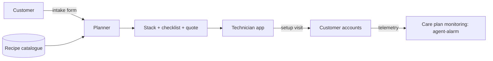

# Architecture — agent-geek-squad

## 1. Scope
Technician toolkit for setting up personal agents safely for families and small businesses.
**MVP:** intake → recipe planner (goal + tool fit + privacy), mandatory safety recipes, budget trimming, checklist, quote.
**Product:** technician app, credential vault handoff, remote care-plan monitoring, partner network.

## 2. System context

## 3. Planner algorithm
1. For each goal, pick the first recipe whose audience, required tools and privacy constraints fit.
   Otherwise record *why* it was skipped.
2. Add **mandatory safety recipes** by rule: always backups, kids under 16 get content filters,
   members 70+ get scam protection, businesses get access controls.
3. If the monthly cost exceeds the budget, drop the most expensive *goal* recipes. Safety recipes
   are never dropped.
4. Quote = trip fee + tech minutes × rate. Care plan = base + per-recipe fee.

## 4. Design decisions
- **Recipes as data, not code.** Technicians and partners extend the catalogue without a deploy.
- **Safety is non-negotiable and budget-exempt.** This is the brand promise, and it's encoded in the planner.
- **Skips are explained** ("needs one of [quickbooks]"), so the technician can upsell or adjust the intake.

## 5. Production architecture
Recipes in a versioned YAML repo, compiled to JSON. A planner service. A technician PWA (offline
checklist, photo proof per step). Credentials never stored in plain text: handoff goes straight to
the customer's password manager. Care plan ingests agent-alarm events.

## 6. Risks
Liability for misconfiguration, so per-step completion evidence plus an E&O policy (agent-insure).
Recipe rot as SaaS APIs change, so recipe health checks run nightly.
